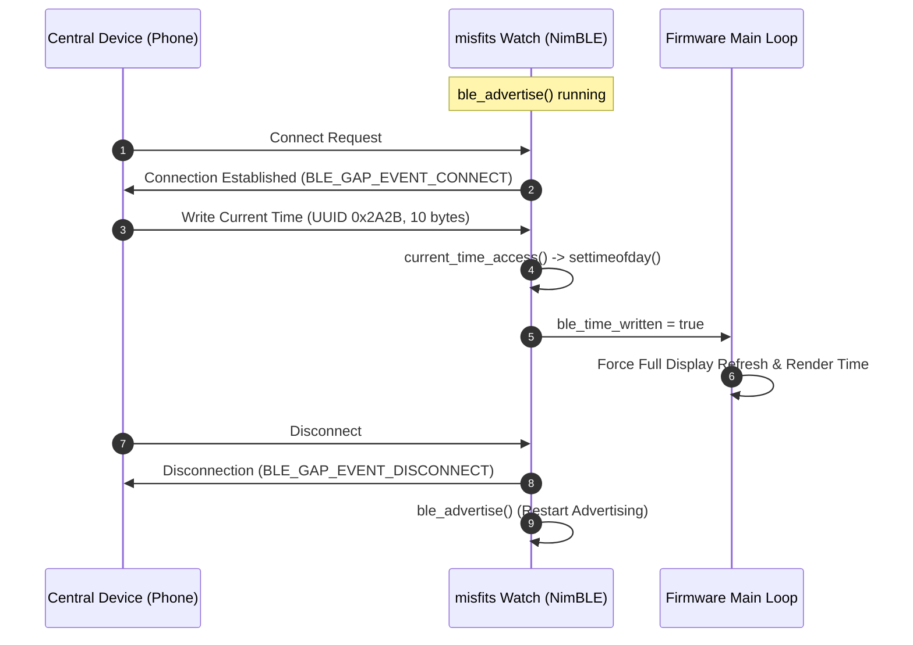

# misfits Firmware Documentation - Bluetooth Low Energy (BLE)

This document describes the Bluetooth Low Energy (BLE) architecture, NimBLE stack
configuration, GAP advertising, GATT Current Time Service (CTS), security, and 
time synchronization mechanisms implemented in [`main/ble.h`](../main/ble.h) and
[`main/ble.c`](../main/ble.c).

## BLE Subsystem Overview

The misfits firmware uses the **Apache NimBLE** host stack provided by ESP-IDF.
BLE serves as the primary external communication and configuration interface
for the smartwatch.

The watch acts as a **GATT Server (Peripheral)** providing the standard Bluetooth
SIG **Current Time Service (CTS, UUID 0x1805)**.



## Stack Initialization & Security

The function [`ble_init_persistent()`](../main/ble.c) initializes the Bluetooth
subsystem:

### 1. Non-Volatile Storage (NVS)
NimBLE relies on NVS to store cryptographic encryption keys and bonding records.
If the NVS flash is corrupt or unformatted, it is erased and reinitialized:

```c
esp_err_t err = nvs_flash_init();
if (err == ESP_ERR_NVS_NO_FREE_PAGES || err == ESP_ERR_NVS_NEW_VERSION_FOUND) {
    ESP_ERROR_CHECK(nvs_flash_erase());
    ESP_ERROR_CHECK(nvs_flash_init());
}
```

### 2. Security Manager (SM) Configuration
The Security Manager is configured for **Just Works** pairing with LE Secure
Connections (SC):

| Parameter | Configuration | Rationale |
| :--- | :--- | :--- |
| `sm_io_cap` | `BLE_HS_IO_NO_INPUT_OUTPUT` | The watch does not have a keyboard or numeric PIN confirmation display for passkey entry. |
| `sm_bonding` | `1` (Enabled) | Distributes and retains long-term encryption keys across reconnects. |
| `sm_mitm` | `0` (Disabled) | Man-in-the-Middle protection is disabled due to the lack of interactive I/O. |
| `sm_sc` | `1` (Enabled) | Enforces Bluetooth 4.2+ LE Secure Connections (ECDH key exchange). |
| Key Distribution | `BLE_HS_KEY_DIST_ENC_KEY \| BLE_HS_KEY_DIST_ID_KEY` | Exchanges LTK (encryption key) and IRK (identity resolving key for random addresses). |

### 3. NimBLE Host Task
The FreeRTOS host task is spawned using:

```c
nimble_port_freertos_init(ble_host_task);
```

The host task runs `nimble_port_run()` to handle the NimBLE event loop.

## GAP Advertising (`ble_advertise`)

Advertising is triggered on initial stack synchronization (`ble_on_sync`) and
restarts automatically whenever a central device disconnects:

### Advertising Configuration

- **Device Name**: `"misfits"`
- **Flags**: `BLE_HS_ADV_F_DISC_GEN | BLE_HS_ADV_F_BREDR_UNSUP`
  (General Discoverable mode, BR/EDR classic Bluetooth unsupported).
- **Service Solicitation**: Advertises 16-bit Service UUID `0x1805` (Current
  Time Service), allowing operating systems to discover the watch specifically as
  a time client/server.
- **Connection Mode**: Undirected connectable (`BLE_GAP_CONN_MODE_UND`).
- **Advertising Interval**:
  - Minimum: `160` slots (100 ms)
  - Maximum: `240` slots (150 ms)
  - Duration: `BLE_HS_FOREVER` (continuous until connected)

### GAP Event Handling (`ble_gap_event`)

```c
int ble_gap_event(struct ble_gap_event *event, void *arg) {
    switch (event->type) {
    case BLE_GAP_EVENT_CONNECT:
        if (event->connect.status == 0) {
            ble_conn_handle = event->connect.conn_handle;
            ble_connected = true;
            ESP_LOGI(TAG, "connected");
        }
        break;

    case BLE_GAP_EVENT_DISCONNECT:
        ble_connected = false;
        ble_conn_handle = BLE_HS_CONN_HANDLE_NONE;
        ESP_LOGI(TAG, "disconnected, reason %d", event->disconnect.reason);
        ble_advertise();
        break;

    default:
        break;
    }
    return 0;
}
```

## GATT Current Time Service (CTS)

The firmware registers a single primary GATT service implementing the Bluetooth
SIG Current Time Service:

- **Service UUID**: `0x1805` (`cts_svc_uuid`)
- **Characteristic UUID**: `0x2A2B` (`cts_chr_uuid`)
- **Characteristic Permissions**: `BLE_GATT_CHR_F_READ | BLE_GATT_CHR_F_WRITE`

### CTS Binary Data Format (10 Bytes)

The Bluetooth SIG CTS specification defines the following 10-byte binary payload
for Characteristic `0x2A2B`:

| Byte Offset | Field | Type / Description | Example Value |
| :--- | :--- | :--- | :--- |
| `[0..1]` | **Year** | `uint16_t` (Little-endian) | `2026` (`0xEA`, `0x07`) |
| `[2]` | **Month** | `uint8_t` (1 = January .. 12 = December) | `9` (September) |
| `[3]` | **Day** | `uint8_t` (1 .. 31) | `29` |
| `[4]` | **Hours** | `uint8_t` (0 .. 23) | `12` |
| `[5]` | **Minutes** | `uint8_t` (0 .. 59) | `34` |
| `[6]` | **Seconds** | `uint8_t` (0 .. 59) | `0` |
| `[7]` | **Day of Week** | `uint8_t` (1 = Monday .. 7 = Sunday) | `2` (Tuesday) |
| `[8]` | **Fractions256** | `uint8_t` (1/256th of a second) | `0` |
| `[9]` | **Adjust Reason** | `uint8_t` (Bitfield for manual/DST adjust) | `0` |

### Read Operation Handling (`BLE_GATT_ACCESS_OP_READ_CHR`)

When a central device reads the characteristic, [`cts_pack()`](../main/ble.c)
packs the watch's current time:

```c
void cts_pack(const struct tm *tm, uint8_t out[10]) {
    uint16_t year = tm->tm_year + 1900;
    out[0] = year & 0xFF;
    out[1] = (year >> 8) & 0xFF;
    out[2] = tm->tm_mon + 1;
    out[3] = tm->tm_mday;
    out[4] = tm->tm_hour;
    out[5] = tm->tm_min;
    out[6] = tm->tm_sec;
    out[7] = (tm->tm_wday == 0) ? 7 : tm->tm_wday; // Convert C Sunday (0) to CTS Sunday (7)
    out[8] = 0;
    out[9] = 0;
}
```

The resulting 10-byte buffer is appended to the mbuf chain via `os_mbuf_append()`.

### Write Operation Handling (`BLE_GATT_ACCESS_OP_WRITE_CHR`)

When a central device writes a new time to the characteristic:

1. **Length Validation**: Ensures the write payload contains at least 7 bytes
   (year through seconds).
2. **Buffer Flattening**: The mbuf is copied to a contiguous array
   using `ble_hs_mbuf_to_flat()`.
3. **Date Unpacking**:
   ```c
   struct tm tm_set = {
       .tm_year = (buf[0] | (buf[1] << 8)) - 1900,
       .tm_mon  = buf[2] - 1, // Convert 1-indexed month to 0-indexed tm_mon
       .tm_mday = buf[3],
       .tm_hour = buf[4],
       .tm_min  = buf[5],
       .tm_sec  = buf[6],
       .tm_isdst = -1,
   };
   ```
4. **Setting System Clock**:
   ```c
   time_t t = mktime(&tm_set);
   struct timeval tv = { .tv_sec = t, .tv_usec = 0 };
   settimeofday(&tv, NULL);
   ```
5. **Main Loop Notification**:
   ```c
   ble_time_written = true;
   ```
   The main loop detects this flag, updates the RTC timestamp record
   `last_sync_time`, forces a full screen refresh, and immediately updates the
   e-paper display.
