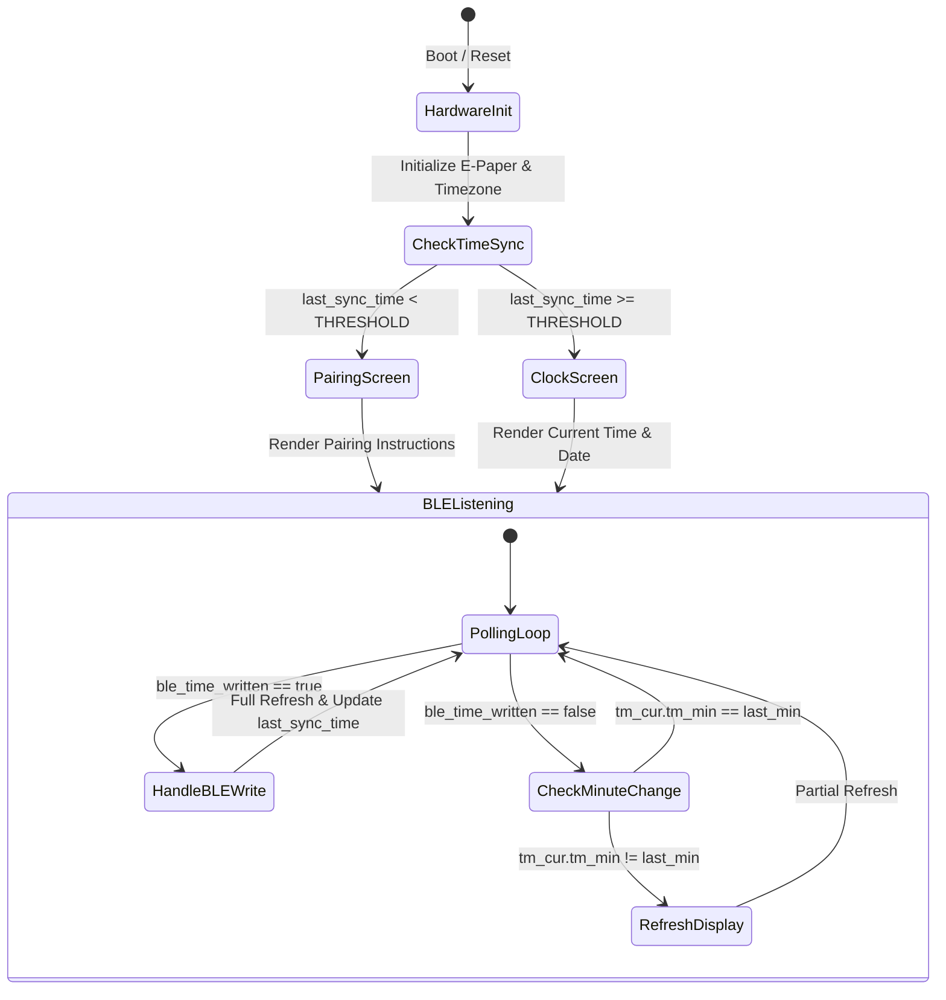

# misfits Firmware Documentation - Firmware Architecture and Lifecycle

This document describes the application lifecycle, system initialization,
state management, timekeeping, and power architecture implemented in
[`main/firmware.c`](../main/firmware.c).

## Architectural Overview

The misfits firmware runs on FreeRTOS under ESP-IDF. The primary design handles
two operational states:
1. **Unsynchronized (Pairing State)**: The device lacks a verified real-time
   clock timestamp. It displays a pairing prompt instructing the user to connect
   via BLE.
2. **Synchronized (Clock State)**: The device maintains an accurate epoch
   timestamp. It updates the display once every minute, presenting the localized
   time and date.

The system is architected to transition between continuous execution
(used during active development and BLE pairing sessions) and ultra-low-power
deep sleep cycles.



## System Initialization

The application entry point is `app_main()` in
[`main/firmware.c`](../main/firmware.c).

### 1. GPIO Hold Release
During deep sleep, the ESP32-S3 latches the voltage levels of selected GPIOs to
prevent signal floating. Upon waking up, the firmware releases these holds:

```c
gpio_deep_sleep_hold_dis();
gpio_hold_dis(disp_cfg.res);
gpio_hold_dis(disp_cfg.cs);
```

### 2. Time Subsystem Initialization (`time_init`)
The firmware configures the C standard library timezone environment variable:

- **Timezone String**: `"CET-1CEST,M3.5.0,M10.5.0/3"`
  - Standard time: Central European Time (CET, UTC+1).
  - Daylight Saving Time: Central European Summer Time (CEST, UTC+2).
  - Transition rule: Starts last Sunday in March at 02:00, ends last Sunday in
    October at 03:00.
- **Validity Threshold (`TIME_VALID_THRESHOLD`)**: `1700000000`
  (corresponding to Nov 14, 2023).
  - If `time(NULL)` is below this threshold, the internal clock is uninitialized.
  - A fallback epoch is set via `settimeofday()` to September 29, 2026, 12:34:00
    to ensure standard library functions remain predictable.

### 3. Display Controller Initialization
Display pins and hardware controllers are initialized via
[`get_eink()`](../main/eink.c):

```c
gdey0154d67_disp_cfg_t disp_cfg = {
    .sck        = GPIO_NUM_12,
    .sdi        = GPIO_NUM_11,
    .dc         = GPIO_NUM_9,
    .cs         = GPIO_NUM_10,
    .busy       = GPIO_NUM_18,
    .res        = GPIO_NUM_8,
    .retain_ram = true,
};
```

The panel controller is reset and initialized using ESP-IDF LCD APIs:
```c
esp_lcd_panel_handle_t eink = get_eink(&disp_cfg);
ESP_ERROR_CHECK(esp_lcd_panel_reset(eink));
ESP_ERROR_CHECK(esp_lcd_panel_init(eink));
```

### 4. Initial Screen Rendering
The boot logic evaluates whether a valid time synchronization has occurred:

- **Unsynchronized**: If `last_sync_time < TIME_VALID_THRESHOLD`,
  [`render_pairing_screen()`](../main/eink.c) is invoked and rendered to the
  display.
- **Synchronized**: If a valid sync exists, `localtime_r()` calculates the
  current local time components, [`render_screen()`](../main/eink.c) renders the
  face, and [`update_display()`](../main/eink.c) pushes the framebuffer.

### 5. Persistent BLE Initialization
The Bluetooth subsystem is brought up via
[`ble_init_persistent()`](../main/ble.c). This sets up NVS, initializes the
NimBLE host task, registers the GATT Current Time Service (CTS), and begins GAP
advertising under the name `"misfits"`.

## Main Execution Loop

After initialization, the firmware enters an active polling loop running at
200ms intervals (`vTaskDelay(pdMS_TO_TICKS(200))`):

### BLE Time Synchronization Event
When a connected BLE central writes a new time value to the CTS characteristic,
the BLE stack sets the volatile flag `ble_time_written = true`.

When detected by the loop:
1. `ble_time_written` is cleared to `false`.
2. `last_sync_time` is updated to `time(NULL)`.
3. `partial_updates` is reset to `FULL_UPDATE_INTERVAL` (forcing a full screen
   refresh). This completely clears any artifacts from the pairing screen or
   earlier frames.
4. The display is re-rendered with the new time and updated.

### Minute Transition Event
When no BLE write has occurred, the loop evaluates the current system time:
1. It reads the current minute from `localtime_r(&cur, &tm_cur)`.
2. If the clock is synchronized (`last_sync_time >= TIME_VALID_THRESHOLD`) and
   `tm_cur.tm_min != last_min`:
   - `last_min` is updated.
   - [`render_screen(&tm_cur)`](../main/eink.c) updates the framebuffer.
   - [`update_display(eink)`](../main/eink.c) executes a partial update to
     quickly refresh the display.

## Persistent State & RTC Memory

Variables annotated with `RTC_DATA_ATTR` are stored in the ESP32-S3 RTC
slow/fast memory. Their contents remain intact through deep sleep cycles as long
as power is maintained:

| Variable | Type | Purpose |
| :--- | :--- | :--- |
| `partial_updates` | `uint32_t` | Tracks how many partial display refreshes have occurred since the last full refresh. Initialized to `FULL_UPDATE_INTERVAL`. |
| `last_sync_time` | `time_t` | Stores the UNIX timestamp of the most recent successful BLE time synchronization. |
| `last_sync_attempt` | `time_t` | Reserved for sync retry backoff strategies. |

## Power Management Architecture

In addition to continuous development/testing mode, the codebase includes
deep-sleep power management implemented in
[`sleep_until_next_minute()`](../main/ble.c):

### Minute Alignment Calculation
```c
struct timeval tv;
gettimeofday(&tv, NULL);
uint64_t sleep_us = (uint64_t)(60 - tv.tv_sec % 60) * 1000000ULL
                    - tv.tv_usec + WAKE_MARGIN_US;
```
The sleep timer calculates the exact microsecond duration remaining until the
upcoming minute boundary, adding a 1-second margin
(`WAKE_MARGIN_US = 1,000,000 µs`) to avoid waking prematurely.

### GPIO Pin Latching
To prevent current leakage and avoid toggling display control lines while the
main processor is powered down:
1. `gpio_hold_en(disp_cfg->res)` holds the display reset line.
2. `gpio_hold_en(disp_cfg->cs)` holds the chip select line high.
3. `gpio_deep_sleep_hold_en()` enables global pad holding during deep sleep.

### Wakeup Sources
1. **Timer Wakeup**: Configured via `esp_sleep_enable_timer_wakeup(sleep_us)`.
2. **External Button Wakeup**: Configured on `GPIO_NUM_0` via
   `esp_sleep_enable_ext0_wakeup(GPIO_NUM_0, 0)` with internal pull-up enabled,
   allowing an external button press to wake the system immediately.
