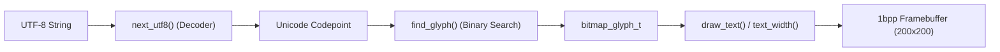

# misfits Firmware Documentation - Typography and Font Engine

This document details the typography system, UTF-8 streaming parser, glyph
lookup algorithm, layout calculation, and bitmap blitting engine implemented
in [`main/glyph.h`](../main/glyph.h), [`main/glyph.c`](../main/glyph.c), and
[`main/freemono_fonts.h`](../main/freemono_fonts.h).

## Typography Engine Architecture

The misfits firmware includes a lightweight, self-contained font rendering engine
designed specifically for 1-bit monochrome framebuffers. It avoids heavy external
rendering libraries (such as FreeType) by using pre-rasterized bitmap glyph tables
sorted by Unicode codepoint.



## Data Structures

The typography subsystem defines two core structures in
[`main/freemono_fonts.h`](../main/freemono_fonts.h):

### 1. `bitmap_glyph_t`
Stores metrics and compressed 1-bit pixel data for an individual character:

```c
typedef struct {
    uint32_t codepoint;         // Unicode scalar value (e.g. 0x0030 for '0', 0x00E4 for 'ä')
    uint16_t width;             // Pixel width of the glyph bounding box
    uint16_t height;            // Pixel height of the glyph bounding box
    int16_t x_offset;           // Horizontal offset from cursor to bounding box left edge
    int16_t y_offset;           // Vertical offset from font baseline to bounding box top edge
    int16_t advance;            // Horizontal cursor step after rendering this glyph
    const uint8_t *bitmap;      // Packed 1-bit glyph bitmap (1 = black pixel, 0 = transparent)
} bitmap_glyph_t;
```

- **Offset Coordinates**: In typography, the baseline is Y = 0. Characters with
  ascenders or capital letters have negative `y_offset` values
  (e.g. `y_offset = -12` means the top of the glyph is 12 pixels above the
  baseline). Descenders (such as 'g', 'p', 'y') extend below the baseline.
- **Advance**: The total horizontal distance the pen advances before drawing the
  next character.

### 2. `bitmap_font_t`
Encapsulates an entire font table:

```c
typedef struct {
    const bitmap_glyph_t *glyphs;  // Pointer to array of glyphs, sorted by codepoint
    size_t count;                  // Number of available glyphs in the table
} bitmap_font_t;
```

## UTF-8 Streaming Decoder (`next_utf8`)

Text strings in C are often encoded in UTF-8, where characters require between 1
and 4 bytes. To support internationalized strings (such as German umlauts
`ä`, `ö`, `ü`, and `ß`) without external libraries,
[`next_utf8()`](../main/glyph.c) implements a streaming multi-byte decoder:

```c
uint32_t next_utf8(const char **text);
```

### Decoding Logic

The function inspects the leading byte at `*text` and advances the pointer:

1. **1-byte ASCII (`0xxxxxxx`)**:
   - Bit range: `0x00` - `0x7F`
   - Advance: 1 byte
2. **2-byte Sequence (`110xxxxx 10xxxxxx`)**:
   - Leading mask: `(p[0] & 0xE0) == 0xC0`
   - Codepoint: `((p[0] & 0x1F) << 6) | (p[1] & 0x3F)`
   - Advance: 2 bytes
3. **3-byte Sequence (`1110xxxx 10xxxxxx 10xxxxxx`)**:
   - Leading mask: `(p[0] & 0xF0) == 0xE0`
   - Codepoint: `((p[0] & 0x0F) << 12) | ((p[1] & 0x3F) << 6) | (p[2] & 0x3F)`
   - Advance: 3 bytes
4. **4-byte Sequence (`11110xxx 10xxxxxx 10xxxxxx 10xxxxxx`)**:
   - Leading mask: `(p[0] & 0xF8) == 0xF0`
   - Codepoint: `((p[0] & 0x07) << 18) | ((p[1] & 0x3F) << 12) | ((p[2] & 0x3F) << 6) | (p[3] & 0x3F)`
   - Advance: 4 bytes
5. **Malformed Sequence**:
   - Falls back to `cp = '?'` and advances the pointer by 1 byte.

## Glyph Lookup Algorithm (`find_glyph`)

Because the font converter generates glyph arrays sorted strictly in ascending
order by their Unicode codepoint, [`find_glyph()`](../main/glyph.c) performs an
**O(log N)** binary search:

```c
const bitmap_glyph_t *find_glyph(const bitmap_font_t *font, uint32_t codepoint) {
    size_t lo = 0;
    size_t hi = font->count;

    while (lo < hi) {
        size_t mid = lo + (hi - lo) / 2;
        uint32_t current = font->glyphs[mid].codepoint;

        if (current < codepoint) {
            lo = mid + 1;
        } else {
            hi = mid;
        }
    }

    if (lo < font->count && font->glyphs[lo].codepoint == codepoint) {
        return &font->glyphs[lo];
    }
    return NULL;
}
```

If a requested character does not exist in the font table, `find_glyph()`
returns `NULL`, allowing the caller to skip missing symbols gracefully without
crashing.

## Text Measurement (`text_width`)

To position text (such as centering the time or date on the screen),
[`text_width()`](../main/glyph.c) parses a string and sums the horizontal
advances of all constituent glyphs:

```c
int text_width(const bitmap_font_t *font, const char *text) {
    int width = 0;
    while (*text) {
        const bitmap_glyph_t *g = find_glyph(font, next_utf8(&text));
        if (g) {
            width += g->advance;
        }
    }
    return width;
}
```

### Centering Formula
Using the measured width, horizontal centering on the 200-pixel wide display is
computed as:

$$\text{x} = \frac{\text{DISPLAY\_W} - \text{text\_width}(\text{font}, \text{text})}{2}$$

## Bitmap Blitting & Rasterization (`draw_text`)

The rendering function [`draw_text()`](../main/glyph.c) draws a string onto the
monochrome framebuffer relative to a horizontal start coordinate `x` and a
vertical baseline coordinate `baseline_y`:

```c
void draw_text(const bitmap_font_t *font, int x, int baseline_y, const char *text);
```

### Pixel Rasterization Process

For each decoded character:
1. **Row Stride**:
   ```c
   int row_bytes = (g->width + 7) / 8;
   ```
2. **Bit Extraction**:
   For each pixel `(gx, gy)` within the glyph bounding box:
   - Bitmask: `uint8_t mask = 0x80 >> (gx % 8);`
   - In the glyph source bitmap, a **1 bit** represents a black foreground pixel.
     If the bit is `0`, the pixel is skipped (transparent background).
3. **Target Coordinate Calculation**:
   ```c
   int px = x + g->x_offset + gx;
   int py = baseline_y + g->y_offset + gy;
   ```
4. **Boundary Clipping**:
   The coordinates are checked against screen boundaries:
   ```c
   if (px >= 0 && px < DISPLAY_W && py >= 0 && py < DISPLAY_H)
   ```
5. **Framebuffer Bit Clearing**:
   Because the display driver interprets `0` as black and `1` as white, the
   corresponding bit in the framebuffer is cleared:
   ```c
   framebuffer[py * (DISPLAY_W / 8) + px / 8] &= (uint8_t)~(0x80 >> (px % 8));
   ```
6. **Pen Advancement**:
   ```c
   x += g->advance;
   ```

## Built-in Fonts (`freemono_fonts.h`)

The firmware includes two pre-compiled font tables derived from GNU FreeMono:

| Font Instance | Type | Target Use |
| :--- | :--- | :--- |
| `freemono_large` | Large proportional/monospace numerals | Time display (`HH:MM`) on the main watch face |
| `freemono_small` | Compact full-subset typeface | Date labels, pairing screen instructions, and UI text |
